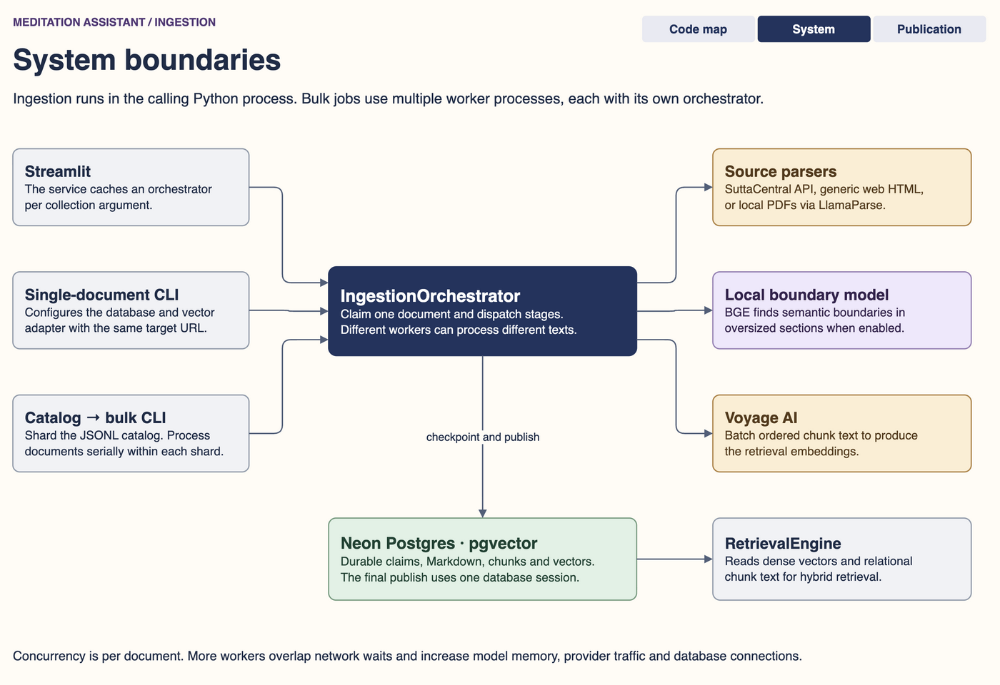
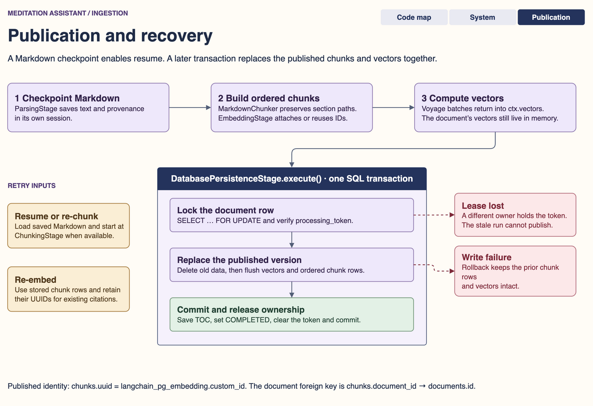
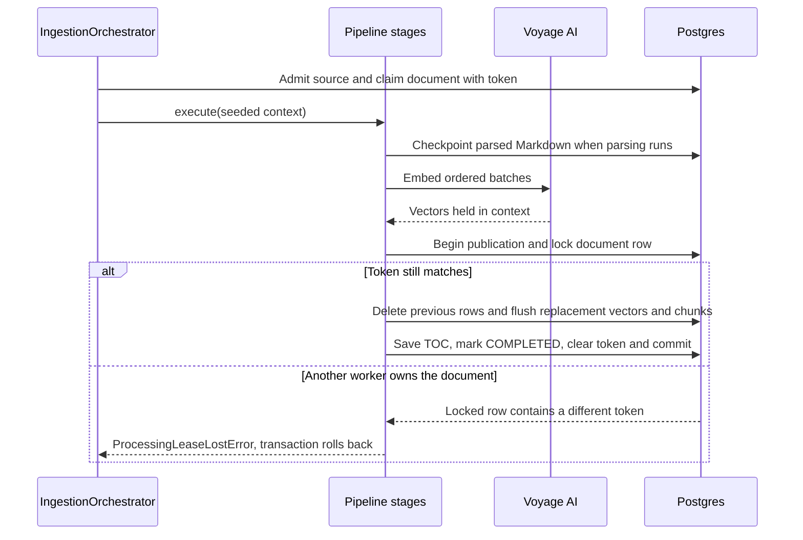

# Ingestion architecture

A submitted text has three identities with different lifetimes. Its **canonical source** selects a document row. A **processing token** identifies the run allowed to publish that document. A **chunk UUID** connects one published passage to its vector and to retrieval or evaluation references. Submitting the same text, retrying a failed run and re-embedding an existing passage each depend on a different one of those identities. [Admission](../ingestion/admission.py) · [Claim and resume](../ingestion/orchestrator.py#L431) · [Vector row construction](../ingestion/embed.py#L189)

[Open the three-page draw.io diagram](images/ingestion-architecture.drawio). Use the tabs to move between views. Select a linked component to open its implementation at the documented revision.

## Where the code runs

Streamlit calls the Python service directly. The service caches an orchestrator per collection argument and passes per-document state into each run. The single-text CLI configures the application database and vector adapter with the same database URL. The bulk CLI reads the catalog, partitions its work across spawned processes and runs documents serially inside each shard. A failed attempt resubmits the source through the same admission rule. More workers can overlap network waits, but also increase provider traffic, database connections and model memory. A document claim coordinates competing runs across processes. The ingestion HTTP endpoint is on the roadmap. [UI service](../services/ingestion_service.py) · [Single-text CLI](../scripts/ingest_one.py) · [Bulk worker](../scripts/ingest_all.py) · [Ingestion roadmap](ingestion-and-evals/ingestion-roadmap.md)

## Which code owns each decision

[Open full-size SVG](images/ingestion-architecture.svg) · [Edit in draw.io](images/ingestion-architecture.drawio)

The four branches show **implementation dependencies**. For one document, the runner awaits the stages in the order parse → chunk → embed → publish. The branches share a frozen `PipelineContext`. Each stage returns its successor context, and the embedding stage copies the chunk objects it enriches because freezing the dataclass leaves nested objects mutable. [Stage contract and context](../core/interfaces.py#L88) · [Runner](../ingestion/orchestrator.py#L150) · [Context immutability tests](../tests/test_pipeline_context_immutability.py)

| Question | Owner and contract | Consequence |
|---|---|---|
| Is this a new text? | `canonical_source()` and `admit()` normalize the source and call `DocumentCRUD.insert_if_absent()` against the unique file path. [Admission](../ingestion/admission.py) | The reading URL and shorthand for the same SuttaCentral translation share a document. A different translator or language can identify a different text. |
| Who may work on it? | `IngestionOrchestrator._claim()` seeds a run and conditionally sets `processing_token` and its starting status. `StatusRecorder` writes progress for the owner. [Orchestrator](../ingestion/orchestrator.py#L431) · [CRUD](../db/crud.py#L182) · [Status recorder](../ingestion/status.py) | A competing live run receives `DocumentBusyError`. After an expired claim is taken over, the older token can no longer publish. |
| Which work runs? | `_build_stages()` supplies concrete stages. `PipelineOrchestrator` validates the graph, orders it and checks `required_stages` against `ctx.stage_results`. [Stage wiring](../ingestion/orchestrator.py#L599) · [Stage ABC](../core/interfaces.py#L186) | The same four classes handle fresh and resumed documents. Seeding parsing as complete lets a retry begin at chunking. The runner records a stage exception once and skips dependents. |
| Where does provider-specific behavior live? | `ParserFactory` selects a structural `Parser` with `can_parse()` and `parse() → ParseResult`. `VectorStoreManager` exposes separate computation and transaction-aware write methods. [Parser factory](../ingestion/parsing.py#L176) · [Vector adapter](../ingestion/embed.py#L162) | A new source format can reuse chunking and persistence. Changing the vector backend also affects publication because vector writes must participate in the caller's SQL transaction. |
| What makes a document searchable as a new version? | `DatabasePersistenceStage.execute()` locks the document, verifies the token, replaces vectors and chunk rows, updates the TOC and releases the claim inside `session_scope()`. [Publish stage](../ingestion/stages.py#L375) · [Session owner](../db/database.py#L83) | A commit exposes the replacement together. A rollback preserves the previous chunk and vector rows. Parsing and progress updates have their own earlier commits. |

**Why keep two orchestrators for a linear pipeline?** Dependencies express what each stage needs for a particular run. On an embedding-only rebuild, `_seed()` loads the published chunks and marks parsing and chunking complete. The runner can then dispatch exactly the same embedding and persistence classes used on first ingest. Document admission, lease ownership and the choice of reusable data stay in one place. The cost is that adding a stage involves more than implementing `execute()`. Its dependency name, registration in `_build_stages()`, progress mapping and rules for reusing earlier work must agree. [Stage wiring and seeding](../ingestion/orchestrator.py#L527) · [Running-status mapping](../ingestion/status.py)

## Trace one source through the contracts

For `sc:mn1/sujato`, the single-text CLI calls `process(source)`. On the first submission, admission creates a document and records its vector collection. The claim selects parsing as the first stage. On an ordinary resubmission of the completed document, `process()` returns an `IngestionResult` with the existing ID, chunk count and `already_completed=True`. [CLI example](../scripts/ingest_one.py) · [Submission logic](../ingestion/orchestrator.py)

1. **Source → Markdown.** `ParserFactory` tries SuttaCentral before the broad URL parser. `SuttaCentralParser` takes inline HTML for a legacy translation or reconstructs it from ordered Bilara segments for a segmented translation. Both produce a `ParseResult` with content, title and metadata. `ParsingStage` checkpoints the Markdown and source provenance on the document. This avoids a second source fetch when a later stage fails. [SuttaCentral adapter](../ingestion/suttacentral.py#L199) · [Parse stage](../ingestion/stages.py#L57)
2. **Markdown → ordered chunks.** `MarkdownChunker.chunk()` splits by heading, optionally applies local BGE semantic splitting to oversized sections, merges small adjacent fragments and records their header paths. The resulting LangChain documents live in `ctx.chunks`. Header paths survive merges so the publisher can reconstruct the table of contents and retrieval can cite the section. Size settings are in characters. A semantic split that fails can leave an oversized section intact. [Chunker](../ingestion/chunking.py#L226) · [Chunking units tests](../tests/ingestion/test_chunking_units.py)
3. **Chunks → vectors in memory.** `EmbeddingStage` copies chunk metadata, attaches document and source provenance, and assigns a UUID or reuses the one on a seeded chunk. `compute_embeddings()` sends ordered batches to Voyage, checks each batch's returned count and accumulates vectors in `ctx.vectors`. This keeps model latency outside the publication lock. Batch size limits the size of a provider request, while a worker still holds all vectors for the document until publication. [Embed stage](../ingestion/stages.py#L203) · [Batch computation](../ingestion/embed.py#L162)
4. **Context → published corpus.** After checking ownership under a row lock, the publisher deletes the previous version, calls `stage_vectors(session, …)` and creates the ordered chunk rows. The vector adapter writes `EmbeddingStore.custom_id = chunk.id`. The application writes the same value to `chunks.uuid`, while `chunks.document_id` is a foreign key to `documents.id`. The adapter validates that both stores target the same database. The transaction commits the rows, TOC, completion status and released claim together. This is the default path. With `enable_database_persistence=False`, the explicitly selected vector-only path stores vectors during embedding and omits the publish stage. [Stage wiring](../ingestion/orchestrator.py#L599) · [Vector writes](../ingestion/embed.py#L189) · [Schema](../db/schema.py)

## Publication and recovery

Trace the calls in sequence

**If embedding fails on the second batch**, the first batch has incurred a provider call, but its new vectors have only lived in memory. For a first publication the document ends `FAILED`. A retry reuses saved Markdown, recomputes chunks and calls Voyage again. **If a SQL write fails after the replacement vectors have been flushed**, those inserts and the deletion of the old version roll back together. A failed reprocess of a previously completed document restores its `COMPLETED` status with failure details. A full reparse may already have updated Markdown, title or tags in the earlier checkpoint. The rollback guarantee covers the published chunks, vectors and TOC. [Failure handling](../ingestion/status.py) · [Atomic-publication tests](../tests/ingestion/test_atomic_publication.py)

| Request | Work reused | Effect on passage identity |
|---|---|---|
| Retry an unfinished document | Saved Markdown and source provenance when available. Otherwise the source is parsed again. | Rebuilt chunks get UUIDs when embedded. |
| Submit a completed source again | The existing result. No stages run. | Published UUIDs stay the same. |
| Explicit `full` or `from_chunking` | `full` reads the source again. `from_chunking` starts at saved Markdown. | Both rebuild chunks. References keyed to old chunk UUIDs can become stale. |
| Explicit `from_embedding` | Persisted chunk text, metadata and UUIDs. | The vectors can change while citations and eval labels keep the same passage IDs. |

The document retains its recorded collection across retries and replacements. Older documents can inherit the collection containing their vectors. This prevents a retry issued through a differently configured caller from moving an existing document into another search collection. The eval manifest hashes chunk UUIDs, so re-chunking and re-embedding have different effects on corpus checks. [Run seeding and collection resolution](../ingestion/orchestrator.py#L497) · [Collection tests](../tests/ingestion/test_collections_and_cleanup.py) · [Eval manifest](../evals/corpus.py)

**A lease limits ownership, while the row lock protects publication.** The claim expires after the configured interval since the last row update (30 minutes by default). The recorder avoids redundant progress writes. A new run ordinarily appears as `PENDING → PARSING → CHUNKING → EMBEDDING → COMPLETED`. A long provider call can outlast the lease and allow a second worker to repeat computation. Checking the token under lock prevents the older worker from committing its result after takeover. The parse checkpoint itself uses an ordinary document lookup, so it has a narrower guarantee than publication. [Lease configuration](../config/settings.py#L151) · [Status recorder](../ingestion/status.py) · [Parse checkpoint](../ingestion/stages.py#L83) · [Ownership tests](../tests/ingestion/test_retry_and_ownership.py)

## Where to make a change

| Intended change | Code to change first | Existing check to read |
|---|---|---|
| Add a source format | Implement the parser protocol, return Markdown and register the parser in precedence order. | [Parser contract](../core/interfaces.py#L36) · [Routing and parser tests](../tests/ingestion/test_suttacentral.py) |
| Change chunk sizing or provenance | Change the chunker for segmentation or the stage for source fields copied into vectors. Exercise fresh and resumed inputs. | [Chunk metadata](../tests/test_chunking_metadata.py) · [Reprocessing contract](../tests/ingestion/test_reprocessing_contract.py) |
| Change embedding or persistence | Keep provider computation outside the publish transaction. Pass the existing session into every replacement write and preserve `custom_id` linkage. | [End-to-end run with fakes](../tests/ingestion/test_orchestrator_e2e.py) · [Publication on disposable Postgres](../tests/ingestion/test_atomic_publication.py) |
| Add an API or worker caller | Reuse admission and `process()`. Map already-completed, busy, lost-lease and stage-failure outcomes at the caller boundary. | [Admission tests](../tests/ingestion/test_admission.py) · [Retry and ownership tests](../tests/ingestion/test_retry_and_ownership.py) |
